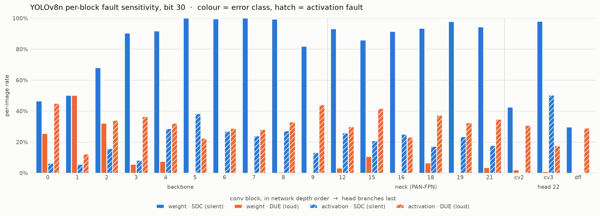
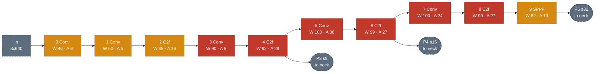
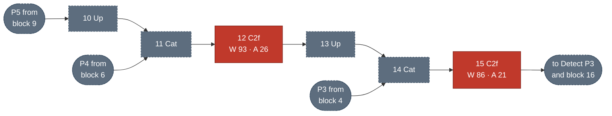
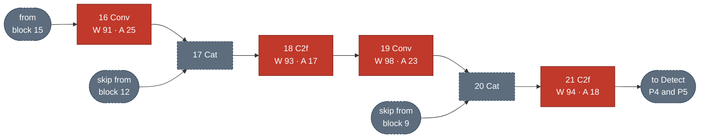
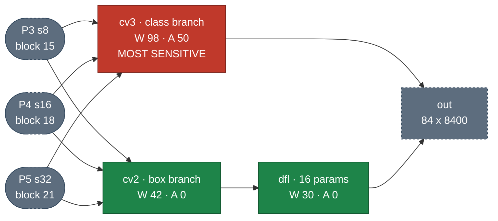
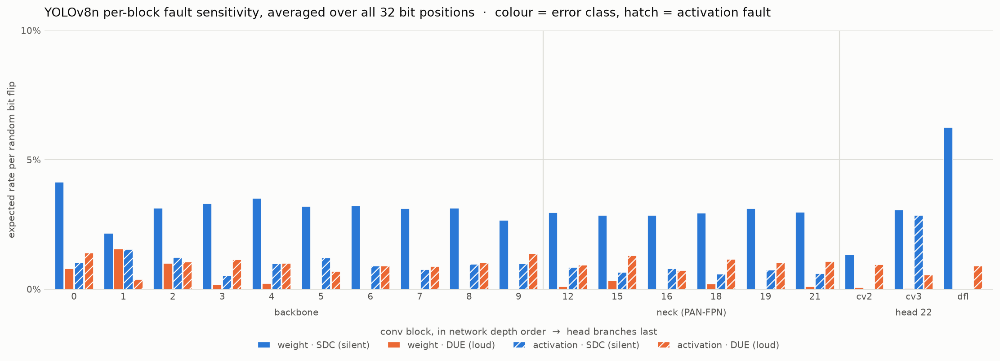
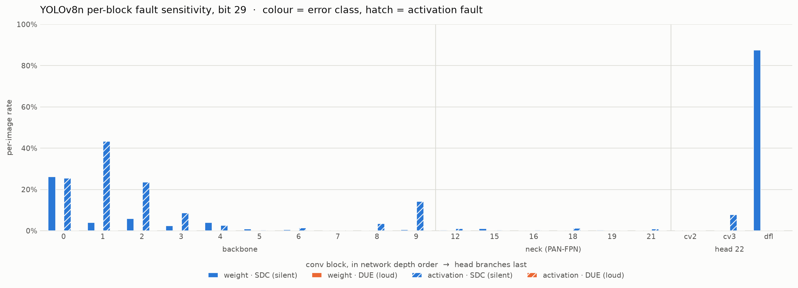

# Hardware Fault Injection in YOLOv8

Measuring how single-bit hardware errors affect object detection quality. Injects
into **weights** (memory faults) and **activations** (buffer / compute faults), and
separates **silent** corruption from **detectable** corruption.

Target: YOLOv8n, 3,151,904 parameters after BatchNorm fusion, 64 `nn.Conv2d`
layers, 100,860,928 bits. Conv weights (the injection targets) are 3,146,176.

Python 3.11.9 (pyenv) · Ultralytics 8.4.156 · PyTorch 2.5.1+cu121 · RTX 4070

| golden baseline | images | mAP50-95 |
|---|---|---|
| `coco128` | 128 |  0.4451 |
| `val2017` | 5,000 | **0.3684** |

Sweeps use coco128 for speed (~1.5 s per evaluation vs 26 s); 0.3684 is the number
to report.

**Layout**

```
src/         injection harness      fi_lib.py  campaign.py  campaign_act.py
analysis/    reporting tools        summarize.py  plot_layers.py  analyze.py  structure.py
demos/       superseded one-off scripts from the exploratory phase
results/     campaign CSVs and logs  (gitignored)
figures/     plots used in this README  (tracked)
```

```bash
./src/campaign.py 16 30                 # weight campaign at bit 30
./src/campaign_act.py persistent 16 30  # activation campaign
./analysis/summarize.py                 # all cross-campaign tables
./analysis/plot_layers.py --bit all     # per-block plot, averaged over bit positions
```

Scripts derive paths from their own location, so the tree can be moved. Harness
details (correctness guarantees, bugs found, full reproduction steps) are in
**[IMPLEMENTATION.md](IMPLEMENTATION.md)**.

---

# Method

## Fault model

Single-bit flips in FP32 values, three injection sites:

| site | models | injection | 
|---|---|---|
| **weights** | bit rot in weight memory (no ECC) | write to `layer.weight.data` | 
| **activations, persistent** | stuck-at fault in an activation buffer | forward hook, every pass, all batch elements | 
| **activations, transient** | single-event upset during one inference | forward hook, fires once | 

Out of scope:

- compute-unit faults (needs NVBitFI)
- control-path and addressing faults
- multi-bit upsets from a single particle
- input-image / frame-buffer faults 

ECC on weight memory would correct
exactly the weight faults modeled here, which argues for pushing toward the compute
path next.

## Bit position sensitivity

FP layout  is `[31] sign | [30:23] exponent | [22:0] mantissa`. Damage is governed by
**magnitude, not bit position alone**, because a flip's direction depends on whether
the bit is already set:

- `|v| < 2` → exponent < 128 → bit 30 **clear**, so flipping *sets* it: ×2¹²⁸,
  catastrophic. Bits 23–29 are mostly already `1`, so flipping them shrinks the value.
- `|v| ≥ 2` → bit 30 **set**, so flipping it shrinks; but bit 29 is now clear (all weights are less than 2^65), and
  flipping that multiplies by 2⁶⁴, catastrophic.
- `|v| ∈ [1,2)` → exponent exactly 127 → setting bit 30 gives 255, the **NaN
  encoding**. NaN appears directly, with no overflow step.

| population | n | mean \|v\| | max \|v\| | \|v\| ≥ 2 | bit 30 clear |
|---|---|---|---|---|---|
| all conv weights | 3,146,176 | 0.062 | 17.49 | 0.01% | 99.95% |
| `model.0.conv` | 432 | n/a | 17.49 | **43.3%** | 56.7% |
| activations @ `model.15.cv2.conv` | 2.2M | 0.162 | 7.60 | 4.7% | 95.3% |

`model.0.conv` is a magnitude outlier: BatchNorm fusion scales first-layer weights
up, so bit 29 is catastrophic there and essentially nowhere else among weights.
Activations are more exposed at bit 29 than weights (4.7% vs 0.01% at `|v| ≥ 2`).

Bits swept are **31, 30, 29, 24, 23, 22**: sign, exponent MSB, the
magnitude-dependent bit, two mid-exponent bits, mantissa MSB. Mantissa bits below
22 change a value by < 0.1%.

## Injection mechanism

```python
# weights: mutate the parameter tensor
flat = layer.weight.data.view(-1)
orig = flat[idx].clone()                              # .clone() is essential
flat[idx] = (flat[idx].view(torch.int32) ^ (1 << bit)).view(torch.float32)
...
flat[idx] = orig                                      # restore

# activations: intercept with a forward hook
def hook(mod, inp, out):
    n, c, h, w = out.shape
    y, x = int(fy * h), int(fx * w)
    out[:, chan % c, y, x] = flip(out[:, chan % c, y, x], bit)   # ALL batch elements
    return out
```

`Tensor.view(dtype)` is a **reinterpret cast**. XOR with
`1 << bit` toggles one position.

Injection happens **after `model.fuse()`**
- `model.fuse()` *folds* each BatchNorm layer into the convolution before it
- Compare both results after normalization, more tracable

Activation targets are `(channel, y_frac, x_frac)` rather than flat indices.

## Sampling design
Inject one bit corruption each time:

Each run tests:
- 64 conv layers × 
- 16 randomly chosen targets (`SEED = 0`) x
- Six possible bit positions × 
- Three campaigns (weight, persistent activation, transient activation)

= **18,432 injections**.

The seed is fixed and the RNG constructed after it, so every bit tested hits the
identical target set, so differences are attributable to bit position alone.

Sampling is **uniform per layer, not per parameter**: `model.22.dfl.conv` (16
params) gets the same 16 injections as `model.7.conv` (294,912). 
- That gives every
layer equal statistical power, but means a whole-model rate cannot be read off these
numbers without reweighting by parameter count.

## Metrics

Two are recorded per injection, because **they disagree, and the disagreement is a
finding**.

**1. mAP50-95**: COCO mean Average Precision over IoU standards of `0.5:0.05:0.95`.
- "mAP-critical" means the bit flip causes `mAP < 0.5 × golden`.
- It **systematically under-reports**: losing one object out of 50 barely moves a dataset
average.

**2. Error class** (per image): golden vs corrupted detections

| Error class | Condition | Detectable at runtime? |
|---|---|---|
| **DUE** | Any entry in output tensor contains NaN or Inf | **yes**, check and re-run |
| **SDC** | Clean output, but objects have lost/phantom/class flip | **no** |
| **Benign** | all objects match, correct classes, boxes drifted (IoU < 0.99) | n/a |
| **Masked** | detection sets identical (all matched at IoU ≥ 0.99) | n/a |


- DUE takes precedence whenever
NaN/Inf is present
<!-- - Detection outcomes recorded alongside the error class: `object_lost` (object
vanished), `phantom` (spurious detection), `class_flip` (matched box, wrong label).
These are a **separate axis**: they occur under DUE as well as SDC. At transient
bit 30, 167 DUE rows had `object_lost`. -->


<!-- `sdc_critical` fires if **any** of the 16 subset images shows an SDC, making it
sensitive but an upward-biased rate. Per-image counts (`v_masked`, `v_benign`,
`v_sdc`, `v_due`) are in every CSV; use those for a rate. -->

# Results

18,432 injections: 3 campaigns × 6 bit positions × 1,024, on coco128.
All tables below come from `./analysis/summarize.py` and use the **per-image rate**,
the fraction of individual golden-vs-corrupted image comparisons that were SDC or DUE.
<!-- DUE. The alternative "any of 16 images" flag (`sdc_critical`) runs 4–12× higher and
is not used here. -->

## Per Bit Position

> SDC and DUE are properties of the fault *site*, not the layer

| bit | field | weight SDC | weight DUE | persist SDC | persist DUE | transient SDC | transient DUE |
|---|---|---|---|---|---|---|---|
| 31 | sign | 2.8% | **0.0%** | 4.8% | **0.0%** | 4.8% | **0.0%** |
| **30** | exp MSB | **83.0%** | 5.9% | 22.5% | **30.5%** | 22.0% | **31.2%** |
| 29 | exp | 2.8% | **0.0%** | 5.1% | **0.0%** | 5.6% | **0.0%** |
| 24 | exp | 2.4% | **0.0%** | 0.2% | **0.0%** | 0.0% | **0.0%** |
| 23 | exp | 1.2% | **0.0%** | 0.0% | **0.0%** | 0.1% | **0.0%** |
| 22 | mant MSB | 0.5% | **0.0%** | 0.0% | **0.0%** | 0.0% | **0.0%** |

**1. Weight faults are silent; activation faults are loud.** At bit 30, weight faults
are 83.0% SDC against 5.9% DUE. Activation faults invert it: 22.5%
SDC against 30.5% DUE.

- Mechanism: convolution weights are typically less than 1, so the corrupted weight stays large-but-finite and propagates as plausible garbage. A
corrupted activation is evaluated against many different images, and any image whose
value at that location lands in `|v| ∈ [1,2)` hits the `E=255` NaN encoding directly.


**2. DUE is exactly 0.0% at every bit except 30**. Only bit 30 can carry an
exponent to 255.  **Other bit flip
positions are 100% undetectable from the output.**

**3. Bit 30 dominates, but no bit is harmless.** Weight SDC falls from 83.0% at bit
30 to 0.5–2.8% elsewhere.

## Bit 30: Where Failures Happen

> Bit 30 is the exponent MSB, and the only bit that can overflow a value to `1e38`
> or reach the `E=255` NaN encoding. It carries ~89% of the expected silent-failure
> rate, so it gets the full per-layer treatment. Bits 31/29 follow in the next section.


### Per-Block, All Four Measures

> `./analysis/plot_layers.py`. Colour = error class, hatch = activation fault.



### Network Sensitivity Diagram

> Per-block per-image SDC %, as `W` = weight fault, `A` = persistent activation
> fault. Colour follows the **weight** rate: red >= 90%, amber 45-90%, green < 45%.
> Dashed nodes hold no parameters (Upsample, Concat) so are never injected.

**1 · Backbone** (blocks 0–9)



**2 · Neck, top-down** (blocks 10–15): carries semantics from P5 down to P3



**3 · Neck, bottom-up** (blocks 16–21): carries localization back up to P5



**4 · Detect head** (block 22): three scales, two branches



| section | weight SDC | weight DUE | persist SDC | persist DUE | transient SDC |
|---|---|---|---|---|---|
| backbone | 87.6% | 9.5% | 22.7% | 32.0% | 23.1% |
| neck | 92.0% | 5.2% | 20.7% | 34.9% | 20.8% |
| head: class | **97.9%** | 0.8% | **50.2%** | 17.5% | **45.1%** |
| head: box | 42.4% | 1.9% | **0.2%** | 30.6% | **0.0%** |
| head: DFL | 29.7% | 0.0% | 0.0% | 28.9% | 0.0% |

<!-- ### Per-Group

| group | weight SDC | weight DUE | persist SDC | persist DUE |
|---|---|---|---|---|
| blocks 0–4 | 77.6% | **19.5%** | 19.6% | 32.4% |
| blocks 5–9 | 97.0% | 0.3% | 25.6% | 31.6% |
| neck 10–21 | 92.0% | 5.2% | 20.7% | 34.9% |
| head 22 | 68.1% | 1.3% | 23.9% | 24.3% | -->

- **The classification head is the most sensitive section under every fault type**,
97.9% / 50.2% / 45.1%. A corrupted class logit poisons NMS ranking globally: one
absurd score suppresses every legitimate detection competing with it.
- **`cv3` is the only critical node in the head**, while `cv2` and `dfl` beside it are
green. Same depth, same inputs, opposite sensitivity: a corrupted class logit
poisons ranking globally, a corrupted box coordinate only misplaces one detection.
- **Blocks 0-2 are only moderately critical** (46-68% weight SDC) despite being the
furthest upstream. Very early features are partly redundant: 16-32 channels at high
spatial resolution, and the network tolerates losing one. Sensitivity peaks at
blocks 5-8, where channel count has grown but spatial redundancy has not.

### Per-Layer Sensitivity

Most sensitive:

| layer | section | weight | act-persist | act-transient |
|---|---|---|---|---|
| **`model.22.cv3.0.2`** | head:cls | **100%** | **100%** | **100%** |
| **`model.22.cv3.1.2`** | head:cls | 98% | **100%** | **100%** |
| **`model.22.cv3.2.2`** | head:cls | 98% | 94% | 94% |
| `model.22.cv3.1.0.conv` | head:cls | 100% | 50% | 50% |
| `model.4.m.1.cv2.conv` | backbone | 97% | 39% | 56% |
| `model.5.conv` | backbone | 100% | 38% | 38% |

Least sensitive:

| layer | section | weight | act-persist | act-transient |
|---|---|---|---|---|
| `model.22.cv2.0.2` | head:box | 18% | 0% | 0% |
| `model.22.cv2.0.0.conv` | head:box | 23% | 0% | 0% |
| `model.22.dfl.conv` | head:DFL | 30% | 0% | 0% |
| `model.0.conv` | backbone | 46% | 6% | 0% |

- **The top three most sensitive layers are the three class-output convs**, `cv3.{0,1,2}.2`, the
final 1×1 in each scale's classification branch, producing the 80 class logits. All
three are at or near 100% under every fault type, and together hold ~19,200
- **No layer is safe.** None of the 64 layers measure 0% SDC across all three campaigns.


### Findings


**Silent vs loud**

- **Activation flips are less critical than weight flips** (solid blue bars tower
over hatched blue ones in every block) because one activation element is used once,
while one weight is reused at every spatial position of its output.
- **Weight DUE is confined to blocks 0–2** (25%, 50%, 32%) and is **0%** from block 5
onward. Early blocks are ~60× louder than blocks 5-9. That is the BatchNorm-fusion
magnitude effect: fusion inflates first-layer weights, putting far more of them in `[1,2)`, easier to be flipped to NaN
- **Activation DUE is high and roughly flat everywhere**
<!-- - **The box branch is fault-type dependent.** 0.0–0.2% SDC against activation faults,
but 42.4% against weight faults. It is not a safe region; it is a region safe against
one of three fault classes. -->


## Averaged Over All Bit Positions

> `./analysis/plot_layers.py --bit all`. The six swept bits summed and divided by
> all 32 positions, i.e. the expected rate if one random bit in the value flips.
> The 26 unswept positions are mantissa bits below 22, which measured 0.0-0.5% at
> bit 22 and change a value by < 0.1%, so treating them as zero is a slight
> underestimate.



This is the field-relevant view, and it ranks the layers differently again:

- **`model.22.dfl.conv` becomes the tallest bar in the network** at 6.3% weight SDC,
against ~3% for a typical backbone block. At bit 30 alone it was the *shortest* at
30%. Its 88% at bit 29 dominates once every bit position is weighted equally, and
16 parameters make it the cheapest thing in the model to protect.
- **Everything else flattens to 2-4%.** Once bit 30 stops being the only bit
considered, the sharp backbone/neck/head structure of the bit-30 plot mostly
disappears. Blocks 0-21 are within a factor of two of each other.
- **`cv2` drops to the bottom** at 1.3%, the only block clearly below the pack.
- The whole-model expectation is **~2.9%**, or roughly 1 upset in 35 causing a
silent failure.

The practical reading: at bit 30 you would harden the mid-backbone and the class
head; averaged over all bits you would harden `dfl` first and then worry about
uniform coverage. Which answer is right depends on whether a deployment's fault
distribution is uniform across bit positions.

## Additional Testing on Bits 31 and 29

> `./analysis/summarize.py layerbits`. Weight campaign, per-image SDC.

| layer | section | bit 31 | bit 30 | bit 29 |
|---|---|---|---|---|
| **`model.22.dfl.conv`** | head:DFL | **37%** | 30% | **88%** |
| **`model.0.conv`** | backbone | 21% | 46% | 26% |
| `model.4.cv2.conv` | backbone | 18% | 87% | 9% |
| `model.4.cv1.conv` | backbone | 12% | 87% | 8% |
| `model.2.cv2.conv` | backbone | 12% | 87% | 7% |
| `model.5.conv` | backbone | 1% | **100%** | 1% |
| `model.7.conv` | backbone | 0% | **100%** | 0% |
| `model.8.m.0.cv1.conv` | backbone | 0% | **100%** | 0% |
| Overall | -- | 2.8% | 83.0% | 2.8% |

At bit 29 the per-block picture largely inverts: `dfl` and `model.0` light up, the
deep backbone goes quiet:



### Findings

**The layer ranking is bit-dependent**, and it tends to invert the bit 30 trend

- The cause is the magnitude duality from the Bit position section.
`model.22.dfl.conv` is a fixed projection holding the integers 0..15, so
bit30=1 (a flip shrinks it, benign) and bit29=0 (a flip multiplies by 2^64, fatal).
- Similarly, the first 3 blocks are sensitive at bit 29, due to their relatively large activation numbers

In conclusion,
- Small-number layers are vulnerable at bit 30
- Large-number layers are vulnerable at bits 29/24/31

> Note the events are *concentrated*, not thin: bit 29 has 460 SDC events over 30 of 64
layers, 224 of them in `model.22.dfl.conv` alone. That is why a 2.8% overall rate
still resolves a per-layer ranking.


## What the Damage Actually Looks Like

> `./analysis/geometry/geom_sweep.py weight 128 30 29 22`. A separate sweep over 8
> representative layers x 128 samples x 3 bits = 3,072 injections, 16 images each,
> recording per-match box geometry and per-event object identity rather than counts.
> 162,652 events. The layer subset spans depth, weight magnitude, branch type and
> fault locality; it is not a basis for ranking layers.

Golden baseline on the 16-image subset: **50 detections, 3.12 per image**, median
object side 150px.

### Benign outcomes are sub-pixel wobble

| bit | injections | mean IoU | min IoU | centre shift / diagonal | area ratio |
|---|---|---|---|---|---|
| 22 | 260 | 0.975 | 0.860 | 0.0057 | 1.016 |
| 29 | 284 | 0.986 | 0.908 | 0.0032 | 0.995 |
| 30 | 199 | 0.944 | 0.688 | 0.0151 | 0.966 |

Centre shift is normalized by the golden box diagonal, so 0.003-0.015 means the box
moved **0.3-1.5% of its own size**. On a median 150px object that is **0.6-3.2
pixels**. Area ratios sit at ~1.0, so it is translation, not resizing: measuring IoU
alone would have conflated the two.

So the outcome distribution is sharply bimodal. A fault either nudges a box by a
pixel or two, or it destroys/invents a detection. There is almost nothing between.

**One layer breaks the pattern.** Per-layer box shift at bit 29:

| layer | n | mean IoU | shift / diagonal |
|---|---|---|---|
| **`model.22.dfl.conv`** | 11 | **0.895** | **0.0211** |
| `model.0.conv` | 69 | 0.978 | 0.0053 |
| `model.2.cv2.conv` | 90 | 0.990 | 0.0025 |
| `model.4.cv2.conv` | 65 | 0.995 | 0.0010 |
| `model.15.cv2.conv` | 40 | 0.997 | 0.0005 |
| `model.5.conv` | 5 | 0.999 | 0.0003 |

`model.22.dfl.conv` distorts geometry 4-7x more than any other layer. That is
mechanically exact: it is the fixed projection that decodes box distributions into
coordinates, so corrupting it perturbs box position *directly*, while every other
layer can only affect boxes through the detection pipeline.

### Object loss is unbiased; phantoms are not

Each event compared against the golden distribution it was drawn from:

| | small | medium | large | median conf |
|---|---|---|---|---|
| **golden** (control) | 22% | 18% | 60% | 0.555 |
| lost (40,966) | 23% | 19% | 58% | 0.548 |
| phantom (120,716) | 34% | 52% | 15% | **1.000** |
| class_flip (970) | 29% | 25% | 46% | 0.447 |

**Object loss carries no size or confidence bias.** Every column is within a point
or two of golden. Corruption does not pick off small or marginal objects first, it
removes them indiscriminately. This contradicts the obvious prediction.

**Phantoms arrive at confidence 1.000.** Median and near-maximal mean. This is the
most safety-relevant result here: corruption-induced false detections cannot be
filtered by a confidence threshold, because they are *more* confident than any real
detection. They also cluster at medium size (52% vs 18% in golden) and almost never
appear large (15% vs 60%).

**Class flips hit marginal detections** at confidence 0.447 against a 0.555 baseline
— the one place where "the uncertain ones break first" holds.

### Caveats

- The size buckets are labelled `P3`/`P4`/`P5` in the CSVs but are assigned by
  **object size** (COCO's 32px / 96px thresholds), not by which detection head
  emitted the box. "Corrupted boxes are medium-sized" is supported; "the P4 head
  produces the phantoms" is not. Real provenance needs NMS to return surviving
  anchor indices, which it does not.
- All 162,652 events come from corrupting the same **50 golden objects**, so
  class-level counts mostly reflect that 20 of the 50 are people. Scale and
  confidence distributions are sounder, since each is compared against its own
  golden baseline.
- 8 layers, chosen to span the structural axes. Not a layer ranking.

## Additional Observations


### Transient outcome by flip direction (bit 30)

| direction | n | outcome |
|---|---|---|
| nan | 133 | 67 object_lost, 66 masked |
| grew | 262 | 58 lost, 41 phantom, 16 class_flip, 147 masked |
| shrank | 117 | 24 phantom, 93 masked, **never loses an object** |

`nan` arises when `|a| ∈ [1,2)`. `grew` is the only direction producing class flips.
`shrank` means bit 30 was already set, so the flip zeroes the activation,
effectively a dropout event, which never loses an object.

### DUE does not imply a wrong answer

Transient bit 30, error class against the underlying detection outcome:

```
DUE   object_lost   167     detected AND failed
DUE   masked        128     detected, output actually fine   <- 42% of DUE rows
DUE   phantom        14
DUE   benign          6
DUE   class_flip      4
```

The NaN check scans the whole `84 × 8400` output, but NMS discards most anchors, so
NaN frequently lands somewhere that never reaches a detection. **42% of DUE rows had
correct detections.** The DUE column is therefore a *detection* rate, not a failure
rate; a strict "detected and failed" reading of transient bit 30 is closer to 18%
DUE / 22% SDC / 60% masked.


---

# Conclusions

## 1. Risk concentrates in a single bit position

Sampling faults uniformly across the whole parameter store (3,151,904 values, bits
0-31), the per-fault corruption probability decomposes as:

```
p = (1/32) x 95.49%   +   (31/32) x 0.21%   =   3.18%
       bit 30                all other bits
```

```bash
# uniform bits over the whole parameter store, single fault
./analysis/multibit/accum_sweep.py 1024 256 --faults 1,2
```

**93% of random-fault risk is one bit** — bit 30, the exponent MSB. An injection
containing a bit-30 flip corrupts ~95% of images; one without corrupts 0.2%. Bits
25 and 26 are a distant second and third (2.7% and 1.3% of the residual), and the
22 mantissa bits contribute 1.1% between them.

## 2. The mechanism is FP32 magnitude duality

Whether a flip grows or shrinks a weight depends on whether the bit is already set.
Almost every weight has `|w| < 2`, so its exponent sits near 120 and bit 30 is
**clear**: flipping it adds 128 to the exponent, scaling the weight by 2^128. Bits
29/28/27 are **set** throughout that range, so flipping them shrinks the weight
toward zero, which is harmless.

Weights with `|w| >= 2` invert this. Bit 30 is set (so a flip is benign) and bit 29
is clear (so a flip multiplies by 2^64). These weights are damageable at **nine bit
positions instead of one**. There are 453 of them, 0.0144% of conv weights:

| layer | `n >= 2` | of | share | max \|w\| |
|---|---|---|---|---|
| `model.0.conv` | 187 | 432 | 43.29% | 17.494 |
| `model.22.cv3.0.1.conv` | 68 | 57,600 | 0.12% | 11.216 |
| `model.22.cv3.1.1.conv` | 63 | 57,600 | 0.11% | 13.361 |
| `model.22.cv3.2.1.conv` | 39 | 57,600 | 0.07% | 10.215 |
| `model.22.cv2.0.1.conv` | 38 | 36,864 | 0.10% | 5.588 |
| `model.22.dfl.conv` | 14 | 16 | 87.50% | 15.000 |
| 9 further layers | 24 | - | <0.3% | <3.0 |

`model.0.conv` is inflated by BatchNorm fusion; `dfl` holds the fixed integers 0-15
that decode box distributions. Those two are the only layers where high-magnitude
weights are *dense* rather than outliers, and they are the two the sweep ranked most
destructive at bits 29/28/27.

**Direct confirmation.** Sampling the two populations separately (256 injections per
cell, N=1, 64 images) rather than by layer isolates the mechanism:

```bash
# split the parameter store by magnitude, one bit per run
for MAG in high low; do
  for B in 30 29 28 27 26 25; do
    ./analysis/multibit/accum_sweep.py 256 64 --faults 1 --bits $B --mag $MAG
  done
done
```

| bit | `\|w\| < 2` SDC | DUE | `\|w\| >= 2` SDC | DUE | ratio |
|---|---|---|---|---|---|
| 30 | **90.36%** | 2.18% | 34.23% | 0.00% | 0.4x |
| 29 | 0.49% | 0.00% | **41.87%** | 0.00% | 84.7x |
| 28 | 0.49% | 0.00% | **41.85%** | 0.00% | 84.7x |
| 27 | 0.51% | 0.00% | **41.77%** | 0.00% | 81.5x |
| 26 | 1.45% | 0.00% | 39.82% | 0.00% | 27.4x |
| 25 | 3.30% | 0.00% | 34.99% | 0.00% | 10.6x |

The populations swap exactly as the mechanism predicts: ordinary weights die at bit
30, high-magnitude weights die at bits 29-25, by a factor of 85x. Two refinements the
model did not anticipate:

- **Zeroing a large weight is itself damaging** (34.23% at bit 30). The flip clears an
  already-set bit and shrinks the weight to ~0, but these are the model's largest
  weights, so the duality is *destroy-by-growth vs damage-by-zeroing*, not
  catastrophic vs safe.
- **High-magnitude weights never produce NaN** - 0.00% DUE at every bit. Growing a
  weight of 17 by 2^64 gives ~3e20, far below the FP32 ceiling of 3.4e38. Only the
  `|w| < 2` population at bit 30 reaches overflow. **The most vulnerable weights are
  also the most silent.**

## 3. Corruption is overwhelmingly silent

**DUE = 0.00% at 9 of the 10 bit positions tested.** Only bit 30 ever produces
NaN/Inf, and only in 6.65% of cases. Healthy inference produces zero NaN in
1,296,179,200 activation values, so the check has no false positives, but it also
has almost nothing to detect.

```bash
# per-bit sweep over all conv layers, one run per bit position
for B in 31 30 29 28 27 26 25 24 23 22; do ./src/campaign.py 16 $B; done
./analysis/summarize.py
```

Under accumulated faults the silent fraction stays high well past the point of
usefulness:

| faults N | SDC | DUE | silent |
|---|---|---|---|
| 1 | 2.56% | 0.07% | 97.5% |
| 8 | 20.09% | 2.12% | 90.4% |
| 16 | 34.49% | 6.53% | 84.1% |
| 32 | 45.63% | 18.62% | 71.0% |

At N=16 the model is wrong on 41% of images and announces it 6.5% of the time.

## 4. Accumulated faults compose independently

`P(corrupt | N) = 1 - (1 - 0.0320)^N` fits across a 32x span in N, lift 1.00 +/- 0.06
with no trend (14,464 injections). **N50 = 21 faults** to reach 50% corruption,
which is simply how many uniform bit draws it takes to probably include a bit 30.

```bash
./analysis/multibit/accum_sweep.py 1024 256 --faults 1,2
./analysis/multibit/accum_sweep.py 1024 256 --faults 4,6,8,12,16,24,32
```

Practical consequence: single-fault characterization fully predicts multi-fault
behaviour. There is no compounding to measure. Full table in
[figures/accumulation_results.txt](figures/accumulation_results.txt).

## 5. Damage is bimodal, not graded

A surviving detection is either untouched or badly wrong, with little in between:

```bash
./analysis/geometry/geom_sweep.py weight 16 30 29 28 27 26 25 \
    --data coco-val2017-sub1024.yaml
./analysis/geometry/plot_drift.py --images 1024   # the two drift figures
./analysis/geometry/geom_report.py geometry       # the underlying table
```

| | displacement | area change |
|---|---|---|
| benign-dominated injections | median 0.02 px | 0.15% |
| SDC-dominated injections | median 16.23 px | 9.02% |

This is worse for safety than graceful degradation, because a monitor watching box
stability sees nothing until an object is simply gone. Note the metric is censored:
IoU-0.50 matching caps representable displacement at `s/3` and area ratio at
[0.5, 2.0], so boxes that move further are recorded as lost + phantom rather than
as large drift.

## 6. Two defences, two threat models

**Random faults (radiation, ambient upsets) - a range check suffices.** A bit-30
flip on a normal weight yields `|w| ~ 1e36`, while the largest legitimate conv
weight is 17.494. A `|w| < 32` comparison catches every harmful bit-30 fault with
zero false positives, and the ~4.5% it misses are the `|w| >= 2` cases where the
flip clears the bit and shrinks the weight harmlessly. One comparison per weight on
a periodic scrub removes 93% of risk. No ECC, no redundancy, no partitioning.

**Adversarial faults (attacker choosing addresses) - partitioning is required.** A
range check does not help when the attacker picks a bit the check permits. Here the
relevant set is the 453 high-magnitude weights, and shielding splits into two
options with different costs:

| approach | covers | cost |
|---|---|---|
| shield `model.0.conv` + `dfl` entire | 201 of 453 (44%) | 448 weights, 1.8 KB, **1.02% of FLOPs**, clean layer split at the network's input and output boundaries |
| protect all 453 by value | 453 of 453 | 3.6 KB with indices, but scattered across 15 layers - no clean compute split, better served by ECC than by partitioning |

The layer-level option is the deployable one: both layers sit at the network
boundaries, so the trust-boundary crossing coincides with I/O that happens anyway,
rather than forcing a round trip through the middle of the network.

## 7. What does not work

- **NaN/Inf detection** - blind to 9 of 10 bit positions, and 42% of the DUE events
  it does raise had correct detections anyway.
- **Confidence thresholding** - 77% of phantom detections sit at confidence exactly
  1.000. No threshold removes them without removing real detections faster.
- **Box-geometry monitoring** - geometry is bimodal (section 5); it looks healthy
  right up until the object disappears.

## 8. Scaling to larger models

A census of `|w| >= 2` across architectures needs no injection - it is a static
property of the checkpoint (seconds per model; downloads weights on first use):

```bash
./analysis/multibit/magnitude_census.py \
    yolov8n yolov8x yolo11x yolov9e yolov10x rtdetr-l
```

| model | params | tensors | `\|w\|>=2` | share | layers | max `\|w\|` | top-1 layer |
|---|---|---|---|---|---|---|---|
| yolov8n | 3.15 M | 127 | 453 | 0.0144% | 15 | 17.49 | 41.3% |
| yolov8x | 68.2 M | 207 | 888 | 0.0013% | 9 | 84.25 | 91.3% |
| yolo11x | 56.9 M | 347 | 993 | 0.0017% | 19 | 91.72 | 90.9% |
| yolov9e | 57.4 M | 523 | 911 | 0.0016% | 17 | 79.10 | 71.6% |
| yolov10x | 29.5 M | 347 | 1097 | 0.0037% | 33 | 65.56 | 74.2% |
| rtdetr-l | 32.1 M | 432 | 1560 | 0.0049% | 18 | 10.66 | 52.5% |

Every CNN detector carries the same signature - the first conv holds 35-38% of its
weights at `|w| >= 2` (`yolov8x` 37.55%, `yolo11x` 34.84%, `yolov10x` 37.69%,
`yolov9e` 37.73% at `model.1.conv`, not `model.0`). Four independently designed
architectures agreeing makes this a **BatchNorm-fusion artifact, not a YOLOv8 quirk**:
the fused weight `yW/sqrt(s^2+e)` inflates wherever input variance is small, and the
first conv sees raw normalised pixels.

**RT-DETR breaks it.** Its largest contributor is an embedding table
(`denoising_class_embed`, 819/20,480), max `|w|` is 10.66 against 65-92 for the CNNs,
and concentration is 52.5% against 91%. The mechanism should still hold, but there is
no small dense layer to shield - partitioning does not transfer to transformer
detectors.

### Does width dilute a fault?

Same layer, two model scales, 256 injections per cell:

```bash
for M in yolov8n yolov8x; do
  for L in model.0.conv model.7.conv; do
    for B in 30 29 25; do
      ./analysis/multibit/accum_sweep.py 256 64 --model $M --faults 1 \
          --bits $B --layer $L
    done
  done
done
```

| layer | model | size | bit 30 | bit 29 | bit 25 |
|---|---|---|---|---|---|
| `model.7.conv` | yolov8n | 294,912 w, 0% hi | 99.46% | 0.10% | 3.39% |
| `model.7.conv` | yolov8x | 3,686,400 w, 0% hi | 99.99% | 0.00% | 0.01% |
| | | **x / n** | **1.01x** | - | **0.00x** |
| `model.0.conv` | yolov8n | 432 w, 43.3% hi | 64.23% | 41.49% | 39.73% |
| `model.0.conv` | yolov8x | 2,160 w, 37.6% hi | 41.61% | 25.57% | 20.11% |
| | | **x / n** | **0.65x** | **0.62x** | **0.51x** |

**Catastrophic upsets do not dilute.** A 12.5x wider layer gives *zero* protection at
bit 30 (99.46% -> 99.99%). The flipped weight becomes ~1e36; one poisoned channel
saturates everything downstream regardless of how many clean channels surround it.

**Moderate upsets dilute almost completely.** Bit 25 on the same layer falls 3.39% ->
0.01%, a 339x reduction. Here the perturbation is x16 on a ~0.01 weight, landing
inside the normal weight range where extra width averages it away.

High-magnitude layers dilute only ~2x, because their weights are large enough that
even x16 lands far outside the normal range. Width cannot absorb that.

### Net effect: larger models are ~20x less reliable

Failure rate = (fault arrival rate) x (per-fault damage probability). Upsets scale
with exposed memory, so arrival rate is proportional to parameter count:

```
                    yolov8n              yolov8x
bits exposed        100,860,928          2,182,419,456      21.6x more targets
per-fault risk      p = 3.20%            p ~= 2.98%          7% better
net failure rate    1x                   ~20x worse
```

Scale dilutes only the ~7% of risk that was never the problem. Bit 30 is 93% of
random-fault risk and is exactly size-invariant, while memory footprint - and
therefore upset rate - grows linearly. **Scaling up buys no protection against the
dominant failure mode.** A `|w| < threshold` range check is the only mitigation that
scales, since it targets the one mode width cannot touch. Note the threshold is
model-specific: `max |w|` runs 17.49 (yolov8n) to 91.72 (yolo11x).

## 9. Limitations

- The 16-layer sweep **omits `model.22.cv3.0.1`, `cv3.1.1`, `cv3.2.1` and
  `cv2.0.1`**, which together hold 208 of the 453 high-magnitude weights. Their
  behaviour at bits 29/28/27 is inferred from the mechanism, not measured. This is
  the first gap to close.
- Per-layer rates rest on 16 weight samples per (layer, bit), roughly +/- 12pp.
  Images within one injection are near-perfectly correlated (ICC ~ 1.00), so
  effective sample size is the injection count, not injections x images.
- Geometry metrics pool all four verdicts per injection; separating them per image
  needs a schema change in `geom_sweep.py`.
- Single model, single dataset. The magnitude-duality mechanism is a property of
  IEEE-754 and should generalise, but the specific layer rankings will not.
