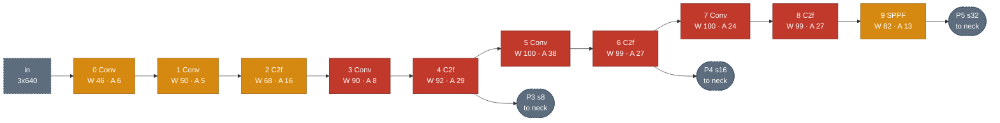
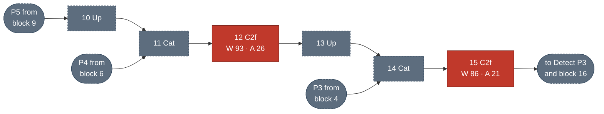
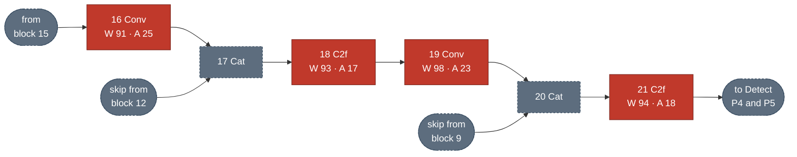
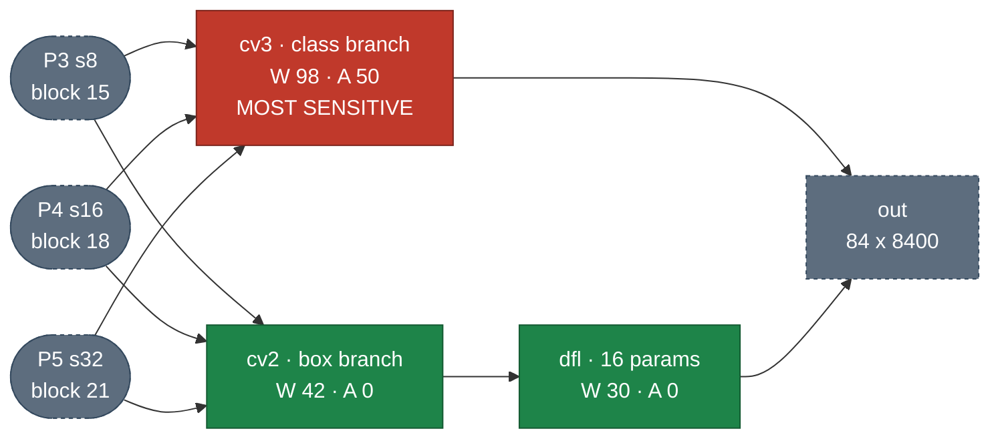

# Main campaign: per-bit and per-layer results

Reporting tools for the three main injection campaigns (weight, activation-persistent,
activation-transient) and the full result tables they produce.

**Read [../README.md](../README.md) first** for the fault model, sampling design and
metric definitions. This file assumes them.

## Scripts

| script | what it does |
|---|---|
| `summarize.py` | the headline tables: SDC/DUE per bit, per section, per layer, by depth, parameter-weighted |
| `analyze.py` | one campaign CSV in detail, with Wilson intervals on the critical-SDC rate |
| `plot_layers.py` | grouped bar chart of per-block sensitivity (colour = error class, hatch = activation fault) |
| `structure.py` | YOLOv8n shapes and module tree; no injection, just inspection |

```bash
./analysis/summarize.py                  # all tables, bit 30 where a single bit is needed
./analysis/summarize.py --bit 29
./analysis/summarize.py layerbits        # the bit 31/30/29 per-layer table
./analysis/analyze.py results/campaign_bit30_n16.csv
./analysis/plot_layers.py --bit all
./analysis/structure.py --convs
```

Two rate definitions exist and differ substantially. `summarize.py` prints both; the
tables below use **`img`**, the fraction of individual golden-vs-corrupted image
comparisons that were SDC or DUE. The alternative `any` flag fires if *any* of the 16
subset images was SDC, which is sensitive but upward-biased.

## Sibling sweeps

| folder | question |
|---|---|
| [blast/](blast/) | how much of the output tensor does one fault change? |
| [geometry/](geometry/) | how far do boxes move, and which objects are lost or invented? |
| [multibit/](multibit/) | accumulated faults, magnitude-stratified sampling, cross-architecture census |
| [partition/](partition/) | splitting the model across a trust boundary |

---

**18,432 injections**: 3 campaigns × 6 bit positions × 1,024, on coco128. Every table
below comes from `./analysis/summarize.py`.

## Per bit position

> SDC and DUE are properties of the fault *site*, not the layer

| bit | field | weight SDC | weight DUE | persist SDC | persist DUE | transient SDC | transient DUE |
|---|---|---|---|---|---|---|---|
| 31 | sign | 2.8% | **0.0%** | 4.8% | **0.0%** | 4.8% | **0.0%** |
| **30** | exp MSB | **83.0%** | 5.9% | 22.5% | **30.5%** | 22.0% | **31.2%** |
| 29 | exp | 2.8% | **0.0%** | 5.1% | **0.0%** | 5.6% | **0.0%** |
| 24 | exp | 2.4% | **0.0%** | 0.2% | **0.0%** | 0.0% | **0.0%** |
| 23 | exp | 1.2% | **0.0%** | 0.0% | **0.0%** | 0.1% | **0.0%** |
| 22 | mant MSB | 0.5% | **0.0%** | 0.0% | **0.0%** | 0.0% | **0.0%** |

**1. Weight faults are silent; activation faults are loud.** At bit 30, weight faults
are 83.0% SDC against 5.9% DUE. Activation faults invert it: 22.5%
SDC against 30.5% DUE.

- Mechanism: convolution weights are typically less than 1, so the corrupted weight stays large-but-finite and propagates as plausible garbage. A
corrupted activation is evaluated against many different images, and any image whose
value at that location lands in `|v| ∈ [1,2)` hits the `E=255` NaN encoding directly.


**2. DUE is exactly 0.0% at every bit except 30**. Only bit 30 can carry an
exponent to 255.  **Other bit flip
positions are 100% undetectable from the output.**

**3. Bit 30 dominates, but no bit is harmless.** Weight SDC falls from 83.0% at bit
30 to 0.5–2.8% elsewhere.

## Bit 30: Where Failures Happen

> Bit 30 is the exponent MSB, and the only bit that can overflow a value to `1e38`
> or reach the `E=255` NaN encoding. It carries ~89% of the expected silent-failure
> rate, so it gets the full per-layer treatment. Bits 31/29 follow in the next section.


### Per-Block, All Four Measures

> `./analysis/plot_layers.py`. Colour = error class, hatch = activation fault.


### Network Sensitivity Diagram

> Per-block per-image SDC %, as `W` = weight fault, `A` = persistent activation
> fault. Colour follows the **weight** rate: red >= 90%, amber 45-90%, green < 45%.
> Dashed nodes hold no parameters (Upsample, Concat) so are never injected.

**1 · Backbone** (blocks 0–9)



**2 · Neck, top-down** (blocks 10–15): carries semantics from P5 down to P3



**3 · Neck, bottom-up** (blocks 16–21): carries localization back up to P5



**4 · Detect head** (block 22): three scales, two branches



| section | weight SDC | weight DUE | persist SDC | persist DUE | transient SDC |
|---|---|---|---|---|---|
| backbone | 87.6% | 9.5% | 22.7% | 32.0% | 23.1% |
| neck | 92.0% | 5.2% | 20.7% | 34.9% | 20.8% |
| head: class | **97.9%** | 0.8% | **50.2%** | 17.5% | **45.1%** |
| head: box | 42.4% | 1.9% | **0.2%** | 30.6% | **0.0%** |
| head: DFL | 29.7% | 0.0% | 0.0% | 28.9% | 0.0% |

<!-- ### Per-Group

| group | weight SDC | weight DUE | persist SDC | persist DUE |
|---|---|---|---|---|
| blocks 0–4 | 77.6% | **19.5%** | 19.6% | 32.4% |
| blocks 5–9 | 97.0% | 0.3% | 25.6% | 31.6% |
| neck 10–21 | 92.0% | 5.2% | 20.7% | 34.9% |
| head 22 | 68.1% | 1.3% | 23.9% | 24.3% | -->

- **The classification head is the most sensitive section under every fault type**,
97.9% / 50.2% / 45.1%. A corrupted class logit poisons NMS ranking globally: one
absurd score suppresses every legitimate detection competing with it.
- **`cv3` is the only critical node in the head**, while `cv2` and `dfl` beside it are
green. Same depth, same inputs, opposite sensitivity: a corrupted class logit
poisons ranking globally, a corrupted box coordinate only misplaces one detection.
- **Blocks 0-2 are only moderately critical** (46-68% weight SDC) despite being the
furthest upstream. Very early features are partly redundant: 16-32 channels at high
spatial resolution, and the network tolerates losing one. Sensitivity peaks at
blocks 5-8, where channel count has grown but spatial redundancy has not.

### Per-Layer Sensitivity

Most sensitive:

| layer | section | weight | act-persist | act-transient |
|---|---|---|---|---|
| **`model.22.cv3.0.2`** | head:cls | **100%** | **100%** | **100%** |
| **`model.22.cv3.1.2`** | head:cls | 98% | **100%** | **100%** |
| **`model.22.cv3.2.2`** | head:cls | 98% | 94% | 94% |
| `model.22.cv3.1.0.conv` | head:cls | 100% | 50% | 50% |
| `model.4.m.1.cv2.conv` | backbone | 97% | 39% | 56% |
| `model.5.conv` | backbone | 100% | 38% | 38% |

Least sensitive:

| layer | section | weight | act-persist | act-transient |
|---|---|---|---|---|
| `model.22.cv2.0.2` | head:box | 18% | 0% | 0% |
| `model.22.cv2.0.0.conv` | head:box | 23% | 0% | 0% |
| `model.22.dfl.conv` | head:DFL | 30% | 0% | 0% |
| `model.0.conv` | backbone | 46% | 6% | 0% |

- **The top three most sensitive layers are the three class-output convs**, `cv3.{0,1,2}.2`, the
final 1×1 in each scale's classification branch, producing the 80 class logits. All
three are at or near 100% under every fault type, and together hold ~19,200
- **No layer is safe.** None of the 64 layers measure 0% SDC across all three campaigns.


### Findings


**Silent vs loud**

- **Activation flips are less critical than weight flips** (solid blue bars tower
over hatched blue ones in every block) because one activation element is used once,
while one weight is reused at every spatial position of its output.
- **Weight DUE is confined to blocks 0–2** (25%, 50%, 32%) and is **0%** from block 5
onward. Early blocks are ~60× louder than blocks 5-9. That is the BatchNorm-fusion
magnitude effect: fusion inflates first-layer weights, putting far more of them in `[1,2)`, easier to be flipped to NaN
- **Activation DUE is high and roughly flat everywhere**
<!-- - **The box branch is fault-type dependent.** 0.0–0.2% SDC against activation faults,
but 42.4% against weight faults. It is not a safe region; it is a region safe against
one of three fault classes. -->


## Averaged Over All Bit Positions

> `./analysis/plot_layers.py --bit all`. The six swept bits summed and divided by
> all 32 positions, i.e. the expected rate if one random bit in the value flips.
> The 26 unswept positions are mantissa bits below 22, which measured 0.0-0.5% at
> bit 22 and change a value by < 0.1%, so treating them as zero is a slight
> underestimate.


This is the field-relevant view, and it ranks the layers differently again:

- **`model.22.dfl.conv` becomes the tallest bar in the network** at 6.3% weight SDC,
against ~3% for a typical backbone block. At bit 30 alone it was the *shortest* at
30%. Its 88% at bit 29 dominates once every bit position is weighted equally, and
16 parameters make it the cheapest thing in the model to protect.
- **Everything else flattens to 2-4%.** Once bit 30 stops being the only bit
considered, the sharp backbone/neck/head structure of the bit-30 plot mostly
disappears. Blocks 0-21 are within a factor of two of each other.
- **`cv2` drops to the bottom** at 1.3%, the only block clearly below the pack.
- The whole-model expectation is **~2.9%**, or roughly 1 upset in 35 causing a
silent failure.

The practical reading: at bit 30 you would harden the mid-backbone and the class
head; averaged over all bits you would harden `dfl` first and then worry about
uniform coverage. Which answer is right depends on whether a deployment's fault
distribution is uniform across bit positions.

## Additional Testing on Bits 31 and 29

> `./analysis/summarize.py layerbits`. Weight campaign, per-image SDC.

| layer | section | bit 31 | bit 30 | bit 29 |
|---|---|---|---|---|
| **`model.22.dfl.conv`** | head:DFL | **37%** | 30% | **88%** |
| **`model.0.conv`** | backbone | 21% | 46% | 26% |
| `model.4.cv2.conv` | backbone | 18% | 87% | 9% |
| `model.4.cv1.conv` | backbone | 12% | 87% | 8% |
| `model.2.cv2.conv` | backbone | 12% | 87% | 7% |
| `model.5.conv` | backbone | 1% | **100%** | 1% |
| `model.7.conv` | backbone | 0% | **100%** | 0% |
| `model.8.m.0.cv1.conv` | backbone | 0% | **100%** | 0% |
| Overall | -- | 2.8% | 83.0% | 2.8% |

At bit 29 the per-block picture largely inverts: `dfl` and `model.0` light up, the
deep backbone goes quiet:


### Findings

**The layer ranking is bit-dependent**, and it tends to invert the bit 30 trend

- The cause is the magnitude duality from
  [Bit position sensitivity](../README.md#bit-position-sensitivity).
`model.22.dfl.conv` is a fixed projection holding the integers 0..15, so
bit30=1 (a flip shrinks it, benign) and bit29=0 (a flip multiplies by 2^64, fatal).
- Similarly, the first 3 blocks are sensitive at bit 29, due to their relatively large activation numbers

In conclusion,
- Small-number layers are vulnerable at bit 30
- Large-number layers are vulnerable at bits 29/24/31

> Note the events are *concentrated*, not thin: bit 29 has 460 SDC events over 30 of 64
layers, 224 of them in `model.22.dfl.conv` alone. That is why a 2.8% overall rate
still resolves a per-layer ranking.

